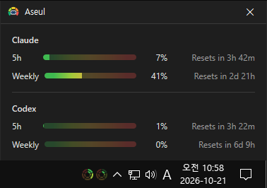

# Aseul

**Un outil gratuit pour Windows qui affiche d'un coup d'œil, dans la barre des tâches, votre consommation de Claude et de Codex.**

[English](README.md) · [한국어](README.ko.md) · [简体中文](README.zh-CN.md) · [日本語](README.ja.md) · [Español](README.es.md) · [Português (Brasil)](README.pt-BR.md) · Français

> Ce document est une traduction. En cas de différence, la [version coréenne](README.ko.md) fait foi.

## Présentation

Claude et Codex ont une limite sur 5 heures et une limite hebdomadaire. Il vous est sûrement déjà arrivé d'en atteindre une en plein travail, ou d'ouvrir une page d'utilisation juste pour voir ce qu'il vous restait.

Aseul place une **petite jauge circulaire** dans la barre des tâches, à côté de l'horloge. Un cercle par service : l'anneau extérieur indique l'utilisation hebdomadaire, l'anneau intérieur l'utilisation sur 5 heures. Chaque anneau se remplit dans le sens des aiguilles d'une montre à partir de midi au fil de l'utilisation, et passe du vert au rouge à mesure que la limite approche. Un coup d'œil suffit pour savoir si vous êtes juste.

Cliquez sur la jauge pour ouvrir la fenêtre d'état : utilisation exacte, temps restant avant la prochaine réinitialisation et utilisation des 7 derniers jours. Fermer la fenêtre laisse la jauge dans la barre des tâches, qui continue de se mettre à jour.

## Fonctionnalités

- **Jauge circulaire dans la barre des tâches** — un double anneau par service (extérieur = semaine, intérieur = 5 heures). Le cercle de gauche est Claude, celui de droite Codex.
- **Cinq paliers de couleur** — chaque anneau est découpé en cinq segments de 20 % : vert, vert-jaune, jaune, orange, rouge. Les segments vides restent visibles en teinte pâle, pour toujours voir la couleur suivante.
- **Mise à jour automatique** — vérifie régulièrement l'utilisation de Claude et de Codex pour rester à jour.
- **Les chiffres au survol** — survolez la jauge pour voir une ligne par service, par exemple `Claude : 5% / 50%` (5 heures / semaine).
- **Fenêtre d'état** — barres d'utilisation sur 5 heures et hebdomadaire par service, avec le temps restant avant chaque réinitialisation.
- **Historique sur 7 jours** — une barre par jour indiquant l'utilisation hebdomadaire et la part consommée ce jour-là.
- **Suit le thème de la barre des tâches** — sur une barre des tâches claire, la jauge repose sur un panneau LED noir ; sur une barre sombre, seuls les anneaux s'affichent. Le changement de thème s'applique immédiatement.
- **Uniquement les services utilisés** — seuls les services connectés ont un cercle. Si vous n'utilisez que Codex, vous ne voyez que le cercle de Codex.
- **Lancer au démarrage** — s'active ou se désactive depuis le menu du clic droit. Le programme d'installation l'active.
- **22 langues** — suit la langue d'affichage de Windows.

## Téléchargement / Installation

| Type | Lien |
|---|---|
| Programme d'installation | [Télécharger](https://down.kilho.net/aseul?lang=fr) |
| Portable (ZIP) | [Télécharger](https://down.kilho.net/aseul?lang=fr&nosetup) |

Le programme d'installation lance Aseul dès la fin de l'installation et active Lancer au démarrage. Pour la version portable, décompressez le ZIP et exécutez `Aseul.exe`.

## Utilisation

### Premiers pas

1. Vérifiez que vous êtes connecté à **Claude Code** ou à **Codex**. Aseul lit votre utilisation grâce à cette connexion (voir « Configuration requise » ci-dessous).
2. Lancez Aseul. Au bout d'un instant, une **jauge circulaire** apparaît dans la barre des tâches, juste à gauche de la zone de notification.
3. Regardez la jauge. L'anneau extérieur indique l'utilisation hebdomadaire, l'anneau intérieur celle sur 5 heures. Plus l'anneau est plein et proche du rouge, moins il vous en reste.
4. Pour les chiffres exacts, **survolez** la jauge ou **cliquez** dessus pour ouvrir la fenêtre d'état.
5. Fermez la fenêtre d'état avec son bouton de fermeture ou **Échap**. La jauge reste et continue de se mettre à jour.

### Éléments de l'écran

**Jauge de la barre des tâches**

| Élément | Signification |
|---|---|
| Cercle de gauche / de droite | Claude / Codex (services connectés uniquement) |
| Anneau extérieur | Utilisation hebdomadaire |
| Anneau intérieur | Utilisation sur 5 heures |
| Couleur de l'anneau | 0–20 % vert, 20–40 % vert-jaune, 40–60 % jaune, 60–80 % orange, 80–100 % rouge |
| Survol | `% sur 5 heures / % hebdomadaire` par service |
| Clic | Ouvre la fenêtre d'état |
| Clic droit | Menu (tableau ci-dessous) |

**Menu du clic droit**

| Menu | Action |
|---|---|
| **Ouvrir la fenêtre d'état** | Ouvre la fenêtre d'état — comme un clic sur la jauge |
| **Lancer au démarrage** (case) | Démarre automatiquement à l'ouverture de session Windows |
| **Créé par Kilho Oh** | Ouvre le site web |
| **Quitter** | Demande « Voulez-vous vraiment quitter ? » puis quitte |

**Fenêtre d'état**

| Élément | Signification |
|---|---|
| Nom du service | Claude, Codex |
| Barres **5 h** · **Semaine** | Utilisation — mêmes couleurs que la jauge, plus soutenues à mesure qu'elles se remplissent |
| % | Utilisation actuelle |
| **Réinit. dans …** | Temps restant avant que cette limite revienne à 0 |
| Graphique sur 7 jours | Apparaît sur place au survol d'un service |

### Astuces selon les situations

**Vérifier ce qu'il reste avant une longue tâche**
Survolez la jauge pour voir aussitôt l'utilisation sur 5 heures / hebdomadaire, par exemple `Claude : 35% / 72%`. Si l'utilisation hebdomadaire approche du segment rouge, vous pouvez repousser les gros travaux après la réinitialisation.

**Savoir quand une limite se réinitialise**
Cliquez sur la jauge pour ouvrir la fenêtre d'état. À droite des barres 5 h et Semaine s'affiche le temps restant, par exemple **Réinit. dans 2 j 21 h**.

**Voir les jours où vous avez le plus consommé cette semaine**
Dans la fenêtre d'état, survolez un service (Claude ou Codex) pour afficher le graphique des 7 derniers jours. Il y a une barre par jour, aujourd'hui tout à droite. La hauteur de la barre correspond à l'utilisation hebdomadaire de ce jour ; la partie supérieure plus foncée, à la hausse de ce jour-là. Survolez une barre pour voir la date, l'utilisation hebdomadaire et la hausse du jour, par exemple `10/15(jeu.) · 56% (+12%)`.

**N'utiliser que Claude ou que Codex**
Rien à régler. Seuls les services connectés ont un cercle sur la jauge et une section dans la fenêtre d'état.

**Utiliser une barre des tâches claire**
Un panneau LED noir se place derrière la jauge pour que les couleurs des anneaux restent nettes. Passez en sombre et le panneau disparaît, ne laissant que les anneaux. Le changement de thème s'applique immédiatement.

**Modifier la taille de la barre des tâches**
Quand la hauteur de la barre des tâches change, par exemple avec de petits boutons ou une barre sur deux lignes, la jauge se redessine aussitôt pour s'adapter. Les cercles ont la taille d'une icône de la zone de notification ; ils restent nets sur les écrans haute résolution.

**Afficher la jauge à chaque démarrage du PC**
Clic droit sur la jauge → cochez **Lancer au démarrage**. Le programme d'installation l'a déjà activé. Cliquez à nouveau pour le désactiver.

**Après une nouvelle connexion à Claude Code ou à Codex**
Rien à faire dans Aseul. La vérification suivante récupère les nouvelles valeurs et la jauge reprend. En attendant, la fenêtre d'état affiche en grisé les dernières valeurs reçues.

**Lancer Aseul avant de vous connecter**
Si vous n'êtes connecté ni à Claude Code ni à Codex, Aseul affiche « Aucune IA connectée. » puis se ferme. Connectez-vous à l'un des deux et relancez-le.

**Retrouver la fenêtre d'état**
La fenêtre d'état n'ajoute pas de bouton dans la barre des tâches. Un clic sur la jauge l'ouvre au centre de l'écran où se trouve la jauge, ou la ramène au premier plan si elle est déjà ouverte. Lancer Aseul une seconde fois ouvre aussi la fenêtre d'état au lieu de démarrer une autre copie.

**Quitter complètement Aseul**
Clic droit sur la jauge → **Quitter** → **Oui**. Fermer seulement la fenêtre d'état ne quitte pas le programme ; la jauge reste.

## Configuration

Il n'y a pas de fenêtre de réglages. La seule option est **Lancer au démarrage** dans le menu du clic droit ; tout le reste suit le système automatiquement.

| Élément | Suit |
|---|---|
| Lancer au démarrage | Activé avec le programme d'installation, désactivé en portable — se change dans le menu du clic droit |
| Services affichés | Services connectés (Claude, Codex) |
| Aspect de la jauge | Thème clair / sombre de la barre des tâches |
| Taille de la jauge | Taille d'une icône de la zone de notification (mise à l'échelle de la barre des tâches) |
| Fenêtre d'état | Toujours sombre |
| Langue de l'interface | Langue d'affichage de Windows (22 langues, sinon anglais) |

## Configuration requise

- Windows 10 · Windows 11 (64 bits)
- Vous devez être connecté à **Claude Code** ou à **Codex**.
  - Claude : connecté à Claude Code avec un compte Claude
  - Codex : connecté à Codex avec un compte ChatGPT (la connexion par clé API n'a pas de données d'utilisation, elle n'est donc pas affichée)
- Une connexion Internet est nécessaire pour récupérer l'utilisation.
- Aucun runtime supplémentaire n'est nécessaire. Le programme d'installation n'utilise les droits d'administrateur que pendant l'installation.

## Mises à jour

Aseul ne se met **pas** à jour tout seul. Au lancement, il vérifie si une nouvelle version existe et affiche un avis ; en appuyant sur **Oui**, la page de téléchargement s'ouvre et le programme se ferme. Les nouvelles versions sont publiées manuellement après vérification interne et annoncées sur la [page Aseul](https://kilho.net/aseul). Consultez l'[avis sur la politique de mise à jour](https://en.kilho.net/archives/notice/2940).

## Licence

Aseul est un **freeware**. Utilisez-le partout — au bureau, à la maison, dans les administrations, à l'école — gratuitement et sans restriction, et redistribuez-le librement.

## Liens

- Site web : <https://kilho.net/aseul>
- Forum : <https://kilho.top/forum/qna>
- X (Twitter) : <https://www.twitter.com/kilhonet>

© KILHO.NET
