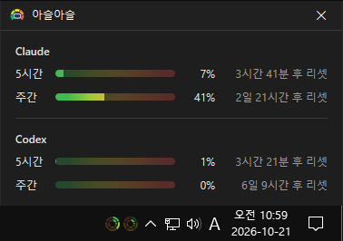

# 아슬아슬

**Claude·Codex 의 사용량을 작업 표시줄에서 한눈에 확인하는, Windows 용 무료 프로그램.**

[English](README.md) · 한국어 · [简体中文](README.zh-CN.md) · [日本語](README.ja.md) · [Español](README.es.md) · [Português (Brasil)](README.pt-BR.md) · [Français](README.fr.md)

## 개요

Claude 와 Codex 는 5시간 한도와 주간 한도가 있습니다. 한창 작업하다가 한도에 걸려 멈추거나, 지금 얼마나 썼는지 보려고 사용량 페이지를 따로 열어 본 적이 있을 겁니다.

아슬아슬은 작업 표시줄 시계 옆에 **작은 원형 게이지**를 띄웁니다. 서비스마다 원 하나, 바깥 링은 주간 사용률, 안쪽 링은 5시간 사용률입니다. 링은 쓴 만큼 12시 방향부터 시계 방향으로 차고, 초록에서 빨강으로 갈수록 한도에 가깝습니다. 아슬아슬하게 남았는지 곁눈질 한 번이면 압니다.

게이지를 누르면 상태창이 열려 정확한 사용률, 다음 리셋까지 남은 시간, 지난 7일의 사용 기록을 볼 수 있습니다. 창을 닫아도 게이지는 작업 표시줄에 그대로 남아 계속 갱신됩니다.

## 주요 기능

- **작업 표시줄 원형 게이지** — 서비스마다 이중 링(바깥 = 주간, 안쪽 = 5시간). 왼쪽 원이 Claude, 오른쪽 원이 Codex 입니다.
- **5단계 색** — 링을 20 % 씩 다섯 구간으로 나눠 초록 · 연두 · 노랑 · 주황 · 빨강을 입힙니다. 빈 구간도 옅은 색으로 보여 남은 구간이 무슨 색인지 늘 보입니다.
- **자동 갱신** — Claude 와 Codex 의 사용률을 주기적으로 확인해 최신 상태로 맞춥니다.
- **마우스만 올려도 숫자** — 게이지에 마우스를 올리면 서비스마다 `Claude : 5% / 50%`(5시간 / 주간) 한 줄씩 보입니다.
- **상태창** — 서비스별 5시간 · 주간 사용률 막대와 다음 리셋까지 남은 시간.
- **7일 사용 기록** — 하루 한 막대로 주간 사용률과 그날 쓴 만큼을 보여 줍니다.
- **작업 표시줄 테마에 맞춤** — 라이트 작업 표시줄에서는 게이지 뒤에 검은 LED 판을 깔고, 다크에서는 링만 띄웁니다. 테마를 바꾸면 바로 따라갑니다.
- **쓰는 서비스만 표시** — 로그인된 서비스만 원을 그립니다. Codex 만 쓰면 Codex 원 하나만 보입니다.
- **부팅시 실행** — 우클릭 메뉴에서 켜고 끕니다. 설치판은 설치할 때 켜집니다.
- **22개 언어** — Windows 표시 언어를 따릅니다.

## 다운로드 / 설치

| 구분 | 링크 |
|---|---|
| 설치 파일 | [다운로드](https://down.kilho.net/aseul?lang=ko) |
| 무설치 (ZIP) | [다운로드](https://down.kilho.net/aseul?lang=ko&nosetup) |

설치판은 설치가 끝나면 바로 실행되고 부팅시 실행도 켜집니다. 무설치판은 ZIP 을 풀고 `Aseul.exe` 를 실행하면 됩니다.

## 사용법

### 처음 사용하기

1. **Claude Code** 나 **Codex** 에 로그인되어 있는지 확인합니다. 아슬아슬은 이 로그인으로 사용률을 읽습니다(아래 「요구 사항」 참고).
2. 아슬아슬을 실행합니다. 잠시 뒤 작업 표시줄 알림 영역 왼쪽에 **원형 게이지**가 나타납니다.
3. 게이지를 봅니다. 바깥 링이 주간, 안쪽 링이 5시간 사용률입니다. 링이 많이 찰수록, 빨강에 가까울수록 한도가 얼마 남지 않았다는 뜻입니다.
4. 정확한 숫자가 궁금하면 게이지에 **마우스를 올리거나**, 게이지를 **눌러** 상태창을 엽니다.
5. 상태창은 닫기 단추나 **Esc** 로 닫습니다. 게이지는 그대로 남아 계속 갱신됩니다.

### 화면 구성

**작업 표시줄 게이지**

| 요소 | 뜻 |
|---|---|
| 왼쪽 원 / 오른쪽 원 | Claude / Codex (로그인된 서비스만) |
| 바깥 링 | 주간 사용률 |
| 안쪽 링 | 5시간 사용률 |
| 링 색 | 0–20 % 초록, 20–40 % 연두, 40–60 % 노랑, 60–80 % 주황, 80–100 % 빨강 |
| 마우스 올림 | 서비스마다 `5시간 % / 주간 %` |
| 클릭 | 상태창 열기 |
| 우클릭 | 메뉴 (아래 표) |

**우클릭 메뉴**

| 메뉴 | 하는 일 |
|---|---|
| **상태창 열기** | 상태창을 엽니다 — 게이지를 누르는 것과 같습니다 |
| **부팅시 실행** (체크) | Windows 에 로그인할 때 자동 실행 |
| **만든이 오길호** | 홈페이지 열기 |
| **종료** | 「정말 종료하시겠습니까?」를 묻고 끝냅니다 |

**상태창**

| 요소 | 뜻 |
|---|---|
| 서비스 이름 | Claude, Codex |
| **5시간** · **주간** 막대 | 사용률 — 게이지와 같은 색으로, 찬 만큼 진하게 |
| % | 지금 사용률 |
| **… 후 리셋** | 그 한도가 다시 0 으로 돌아가기까지 남은 시간 |
| 7일 도표 | 서비스 항목에 마우스를 올리면 그 자리에 나타납니다 |

### 이럴 때 이렇게

**긴 작업을 맡기기 전에 남은 양을 확인할 때**
게이지에 마우스를 올리면 `Claude : 35% / 72%` 처럼 5시간 / 주간 사용률이 바로 보입니다. 주간이 빨강 구간에 가까우면 큰 작업은 리셋 뒤로 미루는 식으로 계획할 수 있습니다.

**한도가 언제 풀리는지 알고 싶을 때**
게이지를 눌러 상태창을 엽니다. 5시간 · 주간 막대 오른쪽에 **2일 21시간 후 리셋** 처럼 남은 시간이 나옵니다.

**이번 주에 어느 날 많이 썼는지 보고 싶을 때**
상태창에서 서비스 항목(Claude 또는 Codex)에 마우스를 올리면 지난 7일 도표가 나타납니다. 하루 한 막대이고 맨 오른쪽이 오늘입니다. 막대 높이는 그날의 주간 사용률, 윗부분의 진한 부분은 그날 오른 만큼입니다. 막대에 마우스를 올리면 `10/15(목) · 56% (+12%)` 처럼 날짜, 주간 사용률, 그날 쓴 만큼이 나옵니다.

**Claude 나 Codex 중 하나만 쓸 때**
따로 설정할 것이 없습니다. 로그인된 서비스만 게이지에 원을 그리고 상태창에도 그 서비스만 보입니다.

**밝은(라이트) 작업 표시줄을 쓸 때**
게이지 뒤에 검은 LED 판이 깔려 링 색이 또렷하게 보입니다. 다크로 바꾸면 판이 사라지고 링만 남습니다. 작업 표시줄 테마를 바꾸면 바로 따라갑니다.

**작업 표시줄 크기를 바꿨을 때**
작은 작업 표시줄 단추, 두 줄 작업 표시줄처럼 높이가 바뀌면 게이지도 바로 다시 맞춰 그립니다. 원은 트레이 아이콘 크기라 배율이 높은 모니터에서도 선명합니다.

**컴퓨터를 켤 때마다 게이지가 나오게**
게이지 우클릭 → **부팅시 실행**을 체크합니다. 설치판은 설치할 때 이미 켜져 있습니다. 끄려면 다시 눌러 체크를 풉니다.

**Claude Code 나 Codex 에 다시 로그인했을 때**
아슬아슬에서 할 일은 없습니다. 다음 확인 때 새 값을 읽어 게이지가 이어집니다. 그동안 상태창에는 마지막으로 받은 값이 흐리게 표시됩니다.

**로그인하기 전에 실행했을 때**
Claude Code 와 Codex 어느 쪽에도 로그인되어 있지 않으면 「로그인된 AI 가 없습니다」를 알리고 끝납니다. 둘 중 하나에 로그인한 뒤 다시 실행하면 됩니다.

**상태창을 다시 찾을 때**
상태창은 작업 표시줄에 따로 단추를 만들지 않습니다. 게이지를 누르면 게이지가 있는 모니터 가운데에 열리고, 이미 열려 있으면 앞으로 나옵니다. 아슬아슬을 한 번 더 실행해도 새로 뜨지 않고 상태창이 열립니다.

**아슬아슬을 완전히 끝내기**
게이지 우클릭 → **종료** → **예**. 상태창을 닫는 것만으로는 끝나지 않고 게이지는 계속 남습니다.

## 설정

설정 창은 없습니다. 바꿀 수 있는 것은 우클릭 메뉴의 **부팅시 실행** 하나이고, 나머지는 자동으로 따릅니다.

| 항목 | 따르는 것 |
|---|---|
| 부팅시 실행 | 설치판은 켜짐, 무설치판은 꺼짐 — 우클릭 메뉴에서 바꿈 |
| 표시할 서비스 | 로그인된 서비스 (Claude, Codex) |
| 게이지 모양 | 작업 표시줄의 라이트 / 다크 테마 |
| 게이지 크기 | 트레이 아이콘 크기 (작업 표시줄 배율) |
| 상태창 | 늘 어두운 화면 |
| 화면 언어 | Windows 표시 언어 (22개 언어, 그 외는 영어) |

## 요구 사항

- Windows 10 · Windows 11 (64비트)
- **Claude Code** 또는 **Codex** 에 로그인되어 있어야 합니다.
  - Claude: Claude Code 에 Claude 계정으로 로그인
  - Codex: Codex 에 ChatGPT 계정으로 로그인 (API 키 로그인은 사용률이 없어 표시되지 않습니다)
- 사용률을 받아 오려면 인터넷 연결이 필요합니다.
- 별도 런타임이 필요 없습니다. 설치판은 설치할 때만 관리자 권한을 씁니다.

## 업데이트

아슬아슬은 자동으로 업데이트하지 **않습니다**. 실행할 때 새 버전이 있는지 확인해 안내 창을 띄우고, **[예]** 를 누르면 다운로드 페이지가 열리면서 프로그램이 종료됩니다. 새 버전은 내부 검증 후 수동으로 배포되고 [아슬아슬 페이지](https://kilho.net/aseul)에 공지됩니다. [업데이트 정책 안내](https://kilho.net/archives/notice/2940)를 참고하세요.

## 라이선스

아슬아슬은 **프리웨어**입니다. 회사, 집, 관공서, 학교 어디서나 제약 없이 무료로 쓸 수 있고, 자유롭게 재배포할 수 있습니다.

## 링크

- 웹사이트: <https://kilho.net/aseul>
- 포럼: <https://kilho.top/forum/qna>
- X (Twitter): <https://www.twitter.com/kilhonet>

© KILHO.NET
